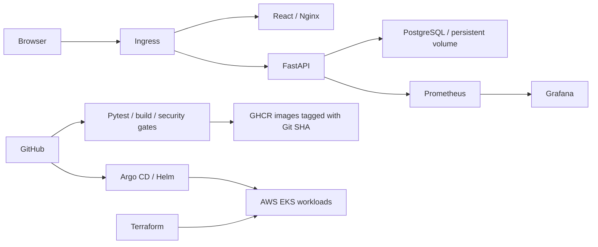

# devops-heros

## Final capstone: Campus Helpdesk

**Kartikey · 24bcs10121**

Campus Helpdesk tracks campus IT requests by category, priority, requester, assignee and status. React/Vite provides the interface, FastAPI exposes CRUD and metrics endpoints, and PostgreSQL stores tickets through Alembic migrations. The capstone uses its own helpdesk domain rather than the reference TaskBoard domain.

**Start here:** [complete project documentation](session21-final-devops-project/README.md), [rubric audit and evidence](CAPSTONE-AUDIT.md), [presentation deck](demo/slides.pdf), [presentation video](demo/presentation.mp4).

**Submission status, 13 October 2026:** all ten rubric modules have implementation/evidence and the required video and 12-slide deck are included. A fresh EKS lifecycle and GitOps/monitoring walkthrough were recorded, then all 20 Terraform resources were destroyed. The form has not been submitted. Use the form's earlier deadline: **16 October 2026, 11:59 PM**.

### Architecture and stack



Python, React/JavaScript, PostgreSQL, SQLAlchemy and Alembic form the application stack. Docker, GitHub Actions, Trivy, GHCR, Terraform, Kubernetes, Helm and Argo CD implement delivery. Prometheus and Grafana provide observability.

### Local setup

```bash
cd session21-final-devops-project
cp .env.example .env
# Set a random POSTGRES_PASSWORD in the untracked .env.
docker compose up -d --build
curl http://localhost:8000/health
```

Open `http://localhost:3000`; the existing workstation uses `FRONTEND_PORT=3100` to avoid a port conflict. Compose waits for PostgreSQL, runs migrations, then starts the API and frontend. See the [setup and tests](session21-final-devops-project/README.md#application-and-docker-setup) for direct development commands.

### Delivery and infrastructure

[The active workflow](.github/workflows/helpdesk.yml) runs on `main` and submission-branch pushes. API tests, frontend build and source/dependency/secret checks precede both image builds. Trivy blocks HIGH/CRITICAL findings before SHA-tagged GHCR publication. A disposable Kind cluster verifies Helm installation and HTTP/API behavior. [Successful hosted pipeline](https://github.com/Json604/devops-heros/actions/runs/38326250900).

[Terraform](session21-final-devops-project/terraform/README.md) provisioned an AWS VPC, two public subnets, EKS with two managed workers and EBS CSI in `ap-south-1`. Saved plan/apply/Console evidence and complete teardown are included. These are historical execution records; the cloud cluster is no longer running.

### Kubernetes, Helm and GitOps

From the capstone directory, with a configured lab cluster and loaded application images:

```bash
bash scripts/create-secret.sh helpdesk
helm upgrade --install helpdesk helm/helpdesk -n helpdesk --wait --wait-for-jobs
kubectl get pods,svc,ingress,hpa,pvc -n helpdesk
```

The chart installs two frontend replicas, an autoscaled backend, PostgreSQL persistence, migration Job, probes and ClusterIP Services. Ingress routes `/` and `/api`. [Full prerequisites and deployment commands](session21-final-devops-project/README.md#kubernetes-and-helm) include Minikube, metrics and Ingress setup. [Argo CD](session21-final-devops-project/gitops/README.md) reconciles committed release values and repairs drift.

### Observability and limitations

The API exposes `/metrics`. [The monitoring guide](session21-final-devops-project/monitoring/README.md) includes Helm values, ServiceMonitor setup, Grafana provisioning and port-forwards. Recorded evidence shows both backend targets UP and populated application panels.

This classroom app has no authentication or TLS. Monitoring storage is ephemeral. SQLite tests complement the real PostgreSQL smoke checks. The AWS cluster was destroyed after evidence capture, so a new live cloud recording requires redeployment. [Cleanup instructions](session21-final-devops-project/README.md#cleanup) preserve data by default and document deliberate cloud teardown.

## Coursework archive

## Sessions 1–12

- [Sessions 1 & 2 — Linux fundamentals](session2-linux/README.md)
- [Session 3 — Shell scripting](session3-shell-scripting/README.md)
- [Session 4 — Networking](session4-networking/README.md)
- [Session 5 — Git and GitHub](session5-git-github/README.md)
- [Sessions 6 & 7 — Docker fundamentals and images](session6-7-docker/README.md)
- [Session 8 — Docker networking](session8-docker-networking-volume/README.md)

- [Session 9 — Kubernetes fundamentals](./session9-k8s/README.md)
- [Session 10 — Pods, controllers and deployments](./session10-k8s-core-objects/README.md)
- [Session 11 — Services and workload identity](./session-11-kubernetes-services/README.md)
- [Session 12 — ConfigMaps, Secrets and Ingress](./session-12-ingress-configmaps-secrets/README.md)

## DevOps HomeWork
- https://docs.google.com/document/d/1cjXFYf2Thm8cBEN-0C48B-v02cj3jGLd47lcO18prHE/edit?usp=sharing

## Submission link
- Section A: https://forms.gle/ydjAJcwxjpjBXgxB8
- Section B: https://forms.gle/pAuXQaokwVzhRzit6

## Sessions 13–21

**Name:** Kartikey
**Roll number:** 24bcs10121

| Session | Submission |
|---|---|
| 13 | [Storage, HPA and probes](session-13-storage-hpa-probes/README.md) |
| 14 | [Kubernetes troubleshooting](session-14-kubernetes-troubleshooting/README.md) |
| 15 | [Helm and Notes mini-project](session-15-helm/README.md) |
| 16 | [Calculator CI/CD](session-16-github-actions/README.md) |
| 17 | [DevSecOps pipeline](session-17-devsecops/README.md) |
| 18 | [Terraform S3 and AWS services](session18-terraform-iac/README.md) |
| 19 | [Cloud infrastructure](session19-cloud-terraform/README.md) |
| 20 | [Monitoring, observability and GitOps](session20-monitoring-observability-gitops/README.md) |
| 21 | [Campus Helpdesk final project](session21-final-devops-project/README.md) |

See [submission status](SUBMISSION.md) for executed checks, pipeline URLs and screenshots. Code, command transcripts and screenshots are included in each session directory. Sessions 18, 19 and 21 contain real AWS execution evidence alongside separate local mocked-provider tests. The final project is Campus Helpdesk, a React/FastAPI/PostgreSQL application for campus IT requests.
